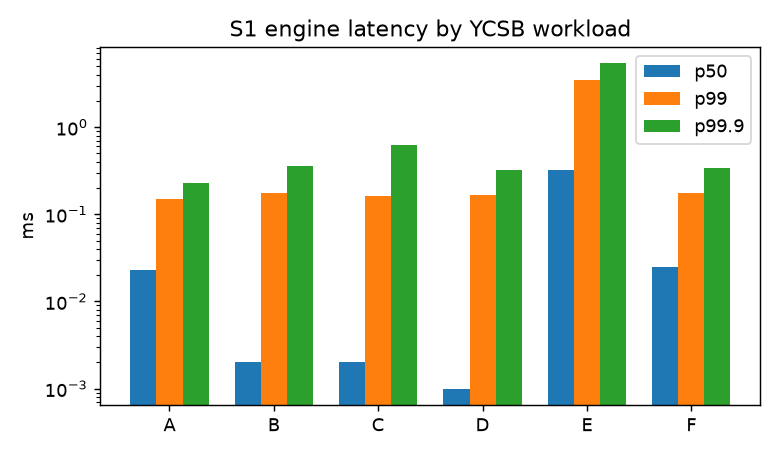
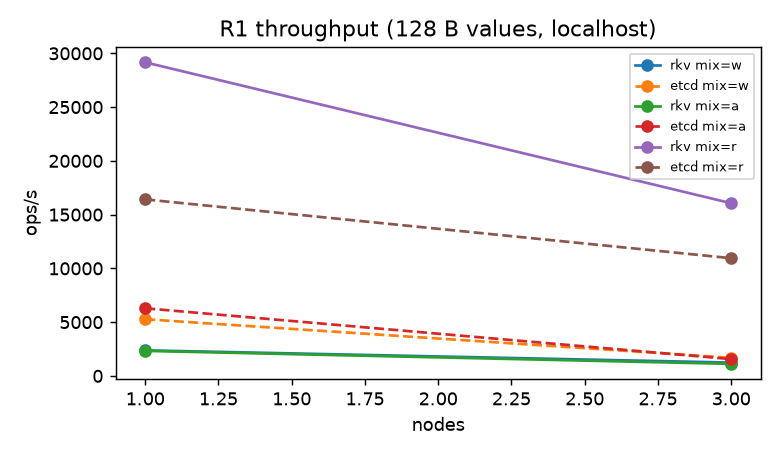
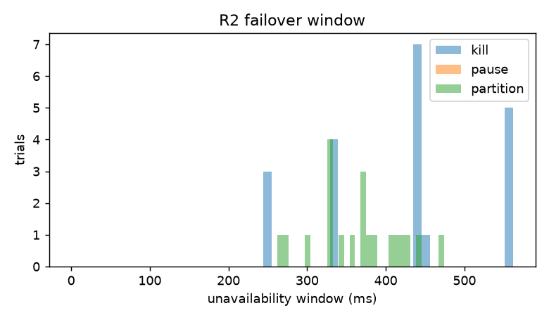
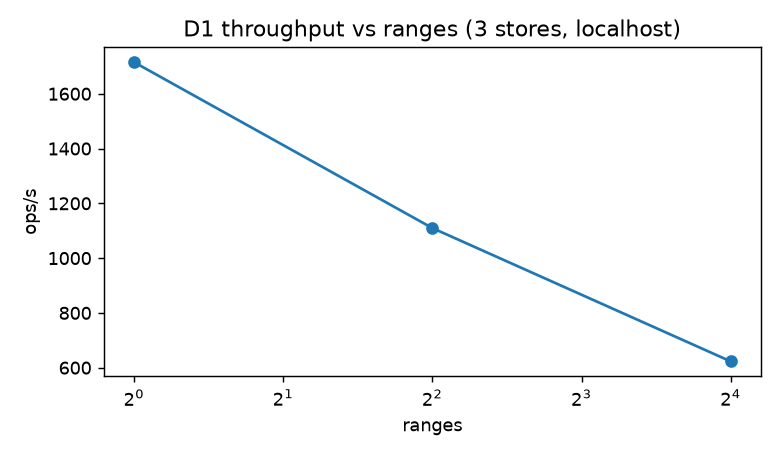
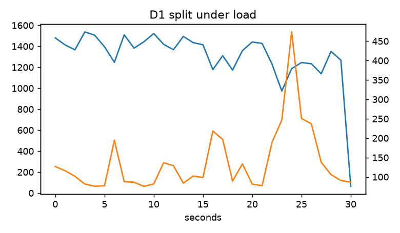
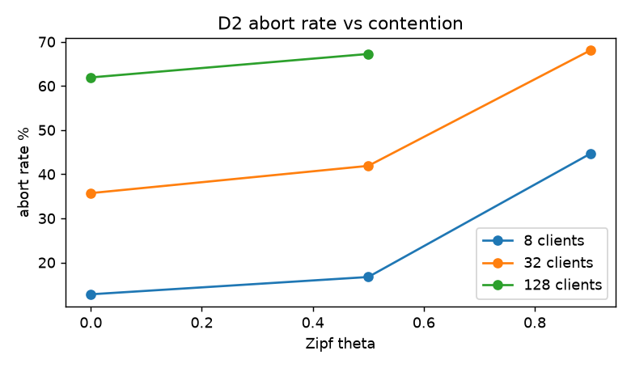

# RESULTS (generated 2026-10-25 13:03 UTC)

> Generated by `make results` from raw files in `bench/results/`. Nothing in this file is typed by hand.
> `NOT RUN` means no raw data exists for that experiment: no claim can be made from it.
> Raw result files found: 267; simulation summaries: 15.

## S1 - single-node engine

### YCSB A-F (ops/s, latency ms, write amp, space amp)

| wl | backend | ops/s | p50 | p99 | p99.9 | write amp | space amp | cache hit |
|---|---|---|---|---|---|---|---|---|
| A | rkv | 175,843 | 0.02 | 0.15 | 0.23 | 3.48 | 1.38 | 0.427 |
| A | rocksdb | 148,555 | 0.01 | 0.19 | 0.93 | NOT RUN | 0.00 | NOT RUN |
| B | rkv | 675,921 | 0.00 | 0.18 | 0.36 | 3.63 | 1.17 | 0.554 |
| B | rocksdb | 730,588 | 0.00 | 0.12 | 1.60 | NOT RUN | 0.00 | NOT RUN |
| C | rkv | 919,222 | 0.00 | 0.16 | 0.62 | 3.93 | 1.17 | 0.782 |
| C | rocksdb | 888,114 | 0.00 | 0.01 | 2.69 | NOT RUN | 0.00 | NOT RUN |
| D | rkv | 722,409 | 0.00 | 0.17 | 0.32 | 3.63 | 1.17 | 0.472 |
| D | rocksdb | 785,114 | 0.00 | 0.15 | 1.38 | NOT RUN | 0.00 | NOT RUN |
| E | rkv | 13,889 | 0.32 | 3.46 | 5.38 | 3.63 | 1.17 | 0.961 |
| E | rocksdb | 154,212 | 0.02 | 0.09 | 5.12 | NOT RUN | 0.00 | NOT RUN |
| F | rkv | 162,927 | 0.03 | 0.18 | 0.34 | 3.86 | 1.52 | 0.469 |
| F | rocksdb | 141,713 | 0.01 | 0.22 | 1.09 | NOT RUN | 0.00 | NOT RUN |

> **Labels:** baseline: rkv; faults: none; scope: single node, local disk, closed-loop clients (latency measured under saturation; no coordinated-omission correction)
> **Labels:** baseline: rocksdb; faults: none; scope: single node, local disk, closed-loop clients (latency measured under saturation; no coordinated-omission correction)
> **Hardware:** AMD EPYC 7763 64-Core Processor, 4 cores, Linux 6.8.0-1070-azure; commit `1b5e1cd`

### vs RocksDB (same machine, same settings class)

| wl | rkv ops/s | rocksdb ops/s | rkv / rocksdb |
|---|---|---|---|
| A | 175,843 | 148,555 | 118% |
| B | 675,921 | 730,588 | 93% |
| C | 919,222 | 888,114 | 104% |
| D | 722,409 | 785,114 | 92% |
| E | 13,889 | 154,212 | 9% |
| F | 162,927 | 141,713 | 115% |

### fsync policy trade-off (workload A)

| policy | ops/s | p50 ms | p99 ms | p99.9 ms |
|---|---|---|---|---|
| always | 649 | 0.05 | 31.74 | 35.84 |
| always-rocksdb | 2,943 | 0.07 | 9.22 | 12.29 |
| group | 3,022 | 0.07 | 11.01 | 15.36 |
| group-rocksdb | 2,857 | 0.07 | 9.73 | 12.80 |
| interval | 182,751 | 0.02 | 0.14 | 0.20 |
| interval-rocksdb | 139,939 | 0.02 | 0.20 | 0.42 |
| never | 196,337 | 0.02 | 0.14 | 0.19 |
| never-rocksdb | 143,935 | 0.02 | 0.19 | 0.27 |

### block cache size vs hit ratio (read-only, Zipfian)

| cache | ops/s | hit ratio |
|---|---|---|
| 1024mb | 1,192,956 | 0.929 |
| 16mb | 707,604 | 0.542 |
| 256mb | 1,092,081 | 0.931 |
| 64mb | 848,889 | 0.778 |

### leveled vs size-tiered

| style | write amp | space amp | blocks read | ops/s |
|---|---|---|---|---|
| leveled | 4.64 | 1.26 | 61,839 | 3,312 |
| tiered | 3.05 | 1.56 | 85,184 | 3,365 |

### Bloom filter false-positive rate (measured vs theoretical at 10 bits/key)

| run | measured | theoretical |
|---|---|---|
| S1-ycsb-c-rkv | 0.00% | 0.82% |
| S1-ycsb-a-rkv | 0.78% | 0.82% |

### recovery time vs WAL size

| target | WAL | recovery | data intact |
|---|---|---|---|
| 256mb | 321.0 MB | 9.64 s | True |
| 64mb | 80.3 MB | 2.03 s | True |

## S2 - crash consistency

| experiment | iterations | acked keys checked | violations / lost |
|---|---|---|---|
| S2-sim | 5000 | 224667 | 0 |
| S2-sigkill | 500 | 1182951462 | 0 |
| S2-cluster | 20 | 126939 | 0 |

> **Labels:** faults: SIMULATED power loss (MemFs drops/tears unsynced data); NOT real hardware; scope: storage engine only, in-memory filesystem model
> **Labels:** faults: REAL kill -9 (SIGKILL) of the writer process; page cache survives, so this does NOT test OS/power loss; scope: storage engine only, local disk
> **Labels:** faults: REAL kill -9 of ALL nodes simultaneously (process crash; OS page cache survives, so not a power-loss test); scope: localhost multi-process cluster
> **Hardware:** Apple M5, 10 cores, Darwin 25.6.0; commit `e55dddf`

## S3 - soak (memory under sustained load)

| pid | samples | RSS start | RSS end | RSS max | growth in 2nd half |
|---|---|---|---|---|---|
| 45254 | 60 | 55 MB | 656 MB | 750 MB | 2.31% |
| 45255 | 60 | 56 MB | 780 MB | 868 MB | 2.21% |
| 45256 | 60 | 53 MB | 704 MB | 744 MB | 8.72% |

> **Labels:** scope: localhost multi-process cluster; faults: none
> **Hardware:** ?, ? cores, ?; commit `1b5e1cd`

## R1 - replicated throughput and latency

| run | backend | ops/s | p50 ms | p99 ms | p99.9 ms | errors |
|---|---|---|---|---|---|---|
| R1-1n-mixa-v128 | rkv | 2,328 | 12.54 | 24.06 | 75.78 | 0 |
| R1-1n-mixr-v128 | rkv | 29,166 | 1.02 | 1.92 | 2.37 | 0 |
| R1-1n-mixw-v128 | rkv | 2,377 | 12.03 | 23.04 | 167.94 | 0 |
| R1-3n-mixa-v128 | rkv | 1,119 | 26.11 | 62.46 | 155.65 | 0 |
| R1-3n-mixr-v128 | rkv | 16,060 | 1.89 | 3.14 | 4.22 | 0 |
| R1-3n-mixw-v128 | rkv | 1,238 | 23.04 | 65.54 | 540.67 | 0 |
| R1-batching-nobatch | rkv | 1,214 | 23.04 | 67.58 | 507.90 | 0 |
| R1-batching-nopipe | rkv | 1,065 | 28.16 | 77.82 | 368.64 | 0 |
| R1-batching-on | rkv | 1,168 | 24.06 | 73.73 | 540.67 | 0 |
| R1-etcd-1n-mixa-v1024 | etcd | 4,298 | 6.66 | 18.43 | 24.06 | 0 |
| R1-etcd-1n-mixa-v128 | etcd | 6,290 | 4.48 | 13.82 | 18.43 | 0 |
| R1-etcd-1n-mixa-v16384 | etcd | 2,809 | 9.73 | 28.16 | 33.79 | 0 |
| R1-etcd-1n-mixr-v1024 | etcd | 15,833 | 1.89 | 5.12 | 8.96 | 0 |
| R1-etcd-1n-mixr-v128 | etcd | 16,415 | 1.86 | 4.86 | 8.19 | 0 |
| R1-etcd-1n-mixr-v16384 | etcd | 13,949 | 2.18 | 4.74 | 8.96 | 0 |
| R1-etcd-1n-mixw-v1024 | etcd | 4,132 | 6.78 | 18.43 | 24.06 | 0 |
| R1-etcd-1n-mixw-v128 | etcd | 5,270 | 5.50 | 15.62 | 19.97 | 0 |
| R1-etcd-1n-mixw-v16384 | etcd | 2,427 | 10.50 | 39.94 | 45.06 | 0 |
| R1-etcd-3n-mixa-v1024 | etcd | 1,154 | 25.60 | 60.42 | 69.63 | 0 |
| R1-etcd-3n-mixa-v128 | etcd | 1,561 | 18.94 | 46.08 | 56.32 | 0 |
| R1-etcd-3n-mixa-v16384 | etcd | 712 | 39.94 | 98.30 | 114.69 | 0 |
| R1-etcd-3n-mixr-v1024 | etcd | 10,597 | 2.88 | 6.66 | 9.98 | 0 |
| R1-etcd-3n-mixr-v128 | etcd | 10,946 | 2.75 | 6.27 | 10.75 | 0 |
| R1-etcd-3n-mixr-v16384 | etcd | 9,384 | 3.26 | 7.42 | 12.80 | 0 |
| R1-etcd-3n-mixw-v1024 | etcd | 1,070 | 30.21 | 52.22 | 62.46 | 0 |
| R1-etcd-3n-mixw-v128 | etcd | 1,680 | 18.43 | 37.89 | 46.08 | 0 |
| R1-etcd-3n-mixw-v16384 | etcd | 771 | 40.96 | 75.78 | 86.02 | 0 |
| R1-readmode-lease | rkv | 28,134 | 1.06 | 2.02 | 3.26 | 0 |
| R1-readmode-linearizable | rkv | 15,961 | 1.92 | 3.20 | 4.61 | 0 |
| R1-readmode-stale | rkv | 30,129 | 0.93 | 2.43 | 5.25 | 0 |

### rkv vs etcd (same workload, localhost, same machine)

| nodes | mix | value B | rkv ops/s | etcd ops/s | rkv / etcd |
|---|---|---|---|---|---|
| 1 | w | 128 | 2,377 | 5,270 | 45% |
| 1 | a | 128 | 2,328 | 6,290 | 37% |
| 1 | r | 128 | 29,166 | 16,415 | 178% |
| 3 | w | 128 | 1,238 | 1,680 | 74% |
| 3 | a | 128 | 1,119 | 1,561 | 72% |
| 3 | r | 128 | 16,060 | 10,946 | 147% |

> **Labels:** clients: closed loop; no coordinated-omission correction; faults: none; scope: localhost multi-process cluster (all nodes on one machine, shared CPU/disk, no network latency)
> **Hardware:** AMD EPYC 7763 64-Core Processor, 4 cores, Linux 6.8.0-1070-azure; commit `1b5e1cd`

## R2 - fault recovery

### unavailability window after a leader fault (client-observed, ms)

| run | fault | trials | election timeout ms | prevote | checkquorum | p50 | p95 | p99 | max |
|---|---|---|---|---|---|---|---|---|---|
| R2-kill | kill | 20 | 200-400 | True | True | 439 | 561 | 562 | 562 |
| R2-kill-et10 | kill | 20 | 200-400 | True | True | 437 | 561 | 572 | 572 |
| R2-kill-et20 | kill | 20 | 400-800 | True | True | 696 | 1015 | 1016 | 1016 |
| R2-kill-et40 | kill | 20 | 800-1600 | True | True | 1392 | 1527 | 1528 | 1528 |
| R2-kill-et5 | kill | 20 | 100-200 | True | True | 244 | 439 | 440 | 440 |
| R2-partition | partition | 20 | 200-400 | True | True | 368 | 442 | 474 | 474 |
| R2-partition-neither | partition | 0 | 200-400 | False | False | 0 | 0 | 0 | 0 |
| R2-partition-nocheckquorum | partition | 0 | 200-400 | True | False | 0 | 0 | 0 | 0 |
| R2-partition-noprevote | partition | 20 | 200-400 | False | True | 339 | 517 | 561 | 561 |
| R2-pause | pause | 0 | 200-400 | True | True | 0 | 0 | 0 | 0 |

> **Labels:** faults: REAL kill -9 of the leader; metric: client-observed time from fault injection to first successful linearizable write (includes client leader re-discovery); scope: localhost multi-process cluster
> **Labels:** faults: leader isolated by transport-layer partition; metric: client-observed time from fault injection to first successful linearizable write (includes client leader re-discovery); scope: localhost multi-process cluster
> **Labels:** faults: REAL SIGSTOP of the leader; metric: client-observed time from fault injection to first successful linearizable write (includes client leader re-discovery); scope: localhost multi-process cluster
> **Hardware:** AMD EPYC 7763 64-Core Processor, 4 cores, Linux 6.8.0-1070-azure; commit `1b5e1cd`

### snapshot catch-up of a lagging replica

| data MB | catch-up s | caught up |
|---|---|---|
| 100 | 1.81 | True |

## R3 - linearizability under faults

### deterministic simulation (same Raft code as production)

| profile | seeds | simulated hours | client ops checked | elections | node crashes | violations |
|---|---|---|---|---|---|---|
| calm | 10000 | 72.2 | 39,524,011 | 10,000 | 0 | 0 |
| crash | 5000 | 36.1 | 12,249,867 | 41,832 | 78,903 | 0 |
| membership | 5000 | 36.1 | 13,048,079 | 30,375 | 16,159 | 0 |
| partition | 5000 | 36.1 | 17,752,398 | 22,407 | 0 | 0 |
| skew | 5000 | 36.1 | 14,363,238 | 25,762 | 14,861 | 0 |
| stormy | 10000 | 72.2 | 28,196,266 | 51,107 | 29,690 | 0 |

**Total: 40,000 seeds, 288.9 simulated hours.**

### mutation testing of the verification suite (injected bugs; each should be CAUGHT)

| injected bug | profile | seeds | seeds that failed | verdict |
|---|---|---|---|---|
| AckEarly | stormy | 1000 | 1000 | CAUGHT |
| NoDedup | stormy | 1000 | 102 | CAUGHT |
| NoPersistVote | stormy | 1000 | 6 | CAUGHT |
| Raft(CommitMinority) | partition | 1000 | 737 | CAUGHT |
| Raft(CommitOldTerm) | crash | 3000 | 0 | NOT caught |
| Raft(VoteIgnoresLog) | stormy | 1000 | 171 | CAUGHT |
| StaleReads | stormy | 1000 | 1000 | CAUGHT |

### real-process chaos histories checked by lincheck

| nemesis | histories | ops | violations |
|---|---|---|---|
| kill-leader | 20 | 361,096 | 0 |
| pause | 20 | 265,299 | 0 |
| partition-half | 20 | 392,794 | 0 |
| ring | 20 | 414,946 | 0 |
| rolling | 20 | 388,059 | 0 |
| mixed | 20 | 372,223 | 0 |
| skew | 20 | 401,169 | 0 |

## D1 - sharding

| run | ops/s | p50 ms | p99 ms | p99.9 ms |
|---|---|---|---|---|
| D1-ranges1-mixa | 1,715 | 31.74 | 180.22 | 1,212.42 |
| D1-ranges1-mixr | 19,452 | 2.94 | 4.99 | 188.42 |
| D1-ranges16-mixa | 623 | 98.30 | 176.13 | 208.90 |
| D1-ranges16-mixr | 17,481 | 3.33 | 8.06 | 32.26 |
| D1-ranges4-mixa | 1,110 | 56.32 | 104.45 | 131.07 |
| D1-ranges4-mixr | 17,377 | 3.26 | 6.91 | 71.68 |

> **Labels:** clients: closed loop; no coordinated-omission correction; faults: none; scope: localhost multi-process cluster (all nodes on one machine, shared CPU/disk, no network latency)
> **Hardware:** AMD EPYC 7763 64-Core Processor, 4 cores, Linux 6.8.0-1070-azure; commit `1b5e1cd`

**D1-split-under-load** per-second timeline: 0s:1480ok/127msmax, 1s:1413ok/116msmax, 2s:1366ok/102msmax, 3s:1537ok/82msmax, 4s:1506ok/76msmax, 5s:1395ok/77msmax, 6s:1247ok/194msmax, 7s:1509ok/88msmax, 8s:1382ok/86msmax, 9s:1443ok/76msmax, 10s:1522ok/82msmax, 11s:1419ok/137msmax, 12s:1367ok/129msmax, 13s:1494ok/84msmax, 14s:1435ok/102msmax, 15s:1414ok/99msmax, 16s:1177ok/219msmax, 17s:1310ok/197msmax, 18s:1173ok/89msmax, 19s:1358ok/134msmax, 20s:1441ok/82msmax, 21s:1427ok/77msmax, 22s:1232ok/189msmax, 23s:973ok/247msmax, 24s:1187ok/474msmax, 25s:1245ok/251msmax, 26s:1233ok/237msmax, 27s:1138ok/138msmax, 28s:1351ok/106msmax, 29s:1267ok/91msmax, 30s:64ok/86msmax

**D1-hot-range** per-second timeline: 0s:387ok/848msmax, 1s:1813ok/204msmax, 2s:2052ok/62msmax, 3s:1702ok/77msmax, 4s:1694ok/177msmax, 5s:1913ok/71msmax, 6s:1821ok/70msmax, 7s:1923ok/72msmax, 8s:901ok/186msmax, 9s:323ok/295msmax, 10s:509ok/346msmax, 11s:451ok/244msmax, 12s:506ok/244msmax, 13s:401ok/298msmax, 14s:447ok/206msmax, 15s:449ok/266msmax, 16s:440ok/251msmax, 17s:514ok/244msmax, 18s:337ok/393msmax, 19s:513ok/195msmax, 20s:442ok/244msmax, 21s:590ok/450msmax, 22s:514ok/192msmax, 23s:390ok/208msmax, 24s:453ok/185msmax, 25s:469ok/237msmax, 26s:427ok/406msmax, 27s:392ok/254msmax, 28s:448ok/249msmax, 29s:569ok/210msmax, 30s:64ok/183msmax

## D2 - transactions

| run | isolation | theta | clients | commits/s | abort rate | p99 ms | bank invariant |
|---|---|---|---|---|---|---|---|
| D2-bank-hlc | snapshot | 0.9 | 32 | 13 | 67.8% | 1,048.6 | False |
| D2-bank-serializable | serializable | 0.9 | 32 | 48 | 67.1% | 221.2 | True |
| D2-bank-theta0-c128 | snapshot | 0.0 | 128 | 74 | 61.9% | 950.3 | True |
| D2-bank-theta0-c32 | snapshot | 0.0 | 32 | 97 | 35.7% | 245.8 | True |
| D2-bank-theta0-c8 | snapshot | 0.0 | 8 | 54 | 12.8% | 172.0 | True |
| D2-bank-theta0.5-c128 | snapshot | 0.5 | 128 | 34 | 67.2% | 2,162.7 | True |
| D2-bank-theta0.5-c32 | snapshot | 0.5 | 32 | 55 | 41.9% | 516.1 | True |
| D2-bank-theta0.5-c8 | snapshot | 0.5 | 8 | 47 | 16.7% | 188.4 | True |
| D2-bank-theta0.9-c32 | snapshot | 0.9 | 32 | 11 | 68.0% | 1,409.0 | True |
| D2-bank-theta0.9-c8 | snapshot | 0.9 | 8 | 18 | 44.6% | 303.1 | True |

> **Labels:** faults: none; scope: localhost multi-process cluster
> **Hardware:** AMD EPYC 7763 64-Core Processor, 4 cores, Linux 6.8.0-1070-azure; commit `1b5e1cd`

### write skew (on-call doctors)

| isolation | pairs | skewed pairs |
|---|---|---|
| serializable | 500 | 0 |
| snapshot | 500 | 500 |

### lock recovery after coordinator crash (ttl 500 ms, 100 trials)

p50 524 ms, p99 541 ms, failures 0

### bank invariant under chaos

| run | transfers | faults | bad audits | invariant ok |
|---|---|---|---|---|
| J-bank-kill-leader | 14194 | {'kill-9': 13} | 0 | True |
| J-bank-kill-leader | 2116 | {'kill-9': 12} | 0 | True |
| J-bank-mixed | 15714 | {'kill-9': 7, 'partition': 2, 'ring-partition': 2} | 0 | True |
| J-bank-mixed | 1810 | {'kill-9': 7, 'partition': 2, 'ring-partition': 2} | 0 | True |
| J-bank-partition-half | 14891 | {'partition': 10} | 0 | True |
| J-bank-partition-half | 2481 | {'partition': 10} | 0 | True |

## N1 - kernel-level faults on Linux (netem, iptables, dm-flakey, perf)

### R1 under injected network delay / loss (tc netem)

| setting | election timeout | ops/s | p50 ms | p99 ms | p99.9 ms | errors |
|---|---|---|---|---|---|---|
| d0ms-l0pct | 10x20ms | 2,068 | 29.18 | 57.34 | 151.55 | 0 |
| d0ms-l1pct | 10x20ms | 1,483 | 23.04 | 245.76 | 933.89 | 0 |
| d10ms-l0pct | 20x20ms | 946 | 65.54 | 90.11 | 126.98 | 0 |
| d10ms-l1pct | 20x20ms | 654 | 71.68 | 344.06 | 393.22 | 0 |
| d1ms-l0pct | 10x20ms | 1,902 | 31.74 | 61.44 | 200.70 | 0 |
| d1ms-l1pct | 10x20ms | 1,563 | 29.18 | 233.47 | 303.10 | 0 |
| d50ms-l0pct | 60x20ms | 300 | 208.90 | 311.30 | 327.68 | 0 |
| d50ms-l1pct | 60x20ms | 136 | 262.14 | 3,932.16 | 8,257.54 | 0 |

> **Labels:** clients: closed loop; no coordinated-omission correction; faults: none; scope: simulated machines (network namespaces on ONE Linux VM, burstable CPU; kernel netem/iptables are real, CPU and disk are shared); tc netem delay=0ms loss=0% (election timeout 10x20ms)
> **Labels:** clients: closed loop; no coordinated-omission correction; faults: none; scope: simulated machines (network namespaces on ONE Linux VM, burstable CPU; kernel netem/iptables are real, CPU and disk are shared); tc netem delay=0ms loss=1% (election timeout 10x20ms)
> **Labels:** clients: closed loop; no coordinated-omission correction; faults: none; scope: simulated machines (network namespaces on ONE Linux VM, burstable CPU; kernel netem/iptables are real, CPU and disk are shared); tc netem delay=10ms loss=0% (election timeout 20x20ms)
> **Hardware:** AMD EPYC 7763 64-Core Processor, 4 cores, Linux 6.8.0-1070-azure; commit `e657c68`

### leader isolation with iptables (100 trials)

client-observed window: p50 361 ms, p95 467 ms, p99 521 ms, max 530 ms

> **Labels:** scope: simulated machines (network namespaces on ONE Azure B4as_v2 VM, burstable CPU): kernel iptables is real, CPU/disk shared; faults: iptables leader isolation (kernel-level); metric: client-observed time from isolating the leader to the first successful write
> **Hardware:** ?, ? cores, ?; commit `e55dddf`

### disk faults (dm-flakey on one node)

client ok ops 38,798, client errors 0; the faulty node must fail-stop (see logs) while the others keep serving.

> **Labels:** clients: closed loop; no coordinated-omission correction; faults: dm-flakey up=5s down=2s on node 1; scope: simulated machines (network namespaces on ONE Linux VM, burstable CPU; kernel netem/iptables are real, CPU and disk are shared)
> **Hardware:** AMD EPYC 7763 64-Core Processor, 4 cores, Linux 6.8.0-1070-azure; commit `e657c68`

## Membership churn under load (local, real processes)

1 PD + 5 stores; 6 cycles of: drain store 5, drain store 4, kill both, restart them with their old data, let PD rebalance, all under a bank-transfer workload.

| cycles | commits | other errors | audit total / expected | bank invariant |
|---|---|---|---|---|
| 6 | 69,785 | 7 | 100,000 / 100,000 | True |

> **Labels:** localhost PD + 5 stores, membership churn; faults: stores drained, killed (kill -9) and re-added; script `bench/scripts/churn_local.sh`

## K1 - Kubernetes (kind)

_NOT COMPLETED_: the rolling upgrade (283 s) and scale-out passed repeatedly, but the scale-in step never finished a full run; each attempt found a real bug (BUG-021 to BUG-026, see docs/BUGS_FOUND.md). The same churn is covered by the local test above.

## N1 on separate real machines

_NOT RUN_ (the simulated-machine version above ran on one Azure VM; real multi-VM runs are deferred, see docs/DEFERRED_RUNS.md)

## Fuzzing

| target | executions | seconds | crashes |
|---|---|---|---|
| manifest_decoder | 76,665,691 | 601 | 0 |
| proto_requests | 62,236,878 | 601 | 0 |
| raft_message | 128,645,580 | 601 | 0 |
| repl_command | 11,696,763 | 601 | 0 |
| sstable_reader | 87,946,100 | 601 | 0 |
| wal_reader | 57,693,387 | 601 | 0 |

## Plots

